  

  <a href="#-proyectos-destacados">Proyectos</a> &nbsp;·&nbsp;
  <a href="#-stack">Stack</a> &nbsp;·&nbsp;
  <a href="https://github.com/Kevin11ts?tab=repositories">Todos mis repositorios ↗</a>

Soy **desarrollador full stack**. Trabajo con interfaces web, APIs y bases de datos; mis proyectos incluyen aplicaciones progresivas y servicios con TypeScript.

### ✦ Proyectos destacados

| Proyecto | Qué encontrarás | Tecnologías |
| :--- | :--- | :--- |
| **[VocacionesSTEAM API](https://github.com/Kevin11ts/VocacionesSTEAM-API)** | Backend del proyecto VocacionesSTEAM, con servicios de autenticación, usuarios y migraciones de base de datos. | `NestJS` `TypeScript` `PostgreSQL` |
| **[CampusFeed](https://github.com/Kevin11ts/pwa)** | PWA de avisos universitarios, con favoritos, almacenamiento local y acceso sin conexión a recursos visitados. | `JavaScript` `IndexedDB` `Service Workers` |
| **[Vocaciones STEAM · Landing](https://github.com/Kevin11ts/Landing-Page)** | Landing page desarrollada con Angular. | `Angular` `TypeScript` `SCSS` |

### ⌘ Stack

  <strong>Interfaces &amp; APIs</strong>  
  

  <strong>Datos &amp; herramientas</strong>  
  

  
También en mi caja de herramientas

   
  

---

  <a href="https://www.instagram.com/k_alexts1/">Instagram</a> &nbsp;·&nbsp;
  <a href="https://www.facebook.com/kevin.sandoval.153779/">Facebook</a> 
  Kevin11ts · Del frontend a los datos.

