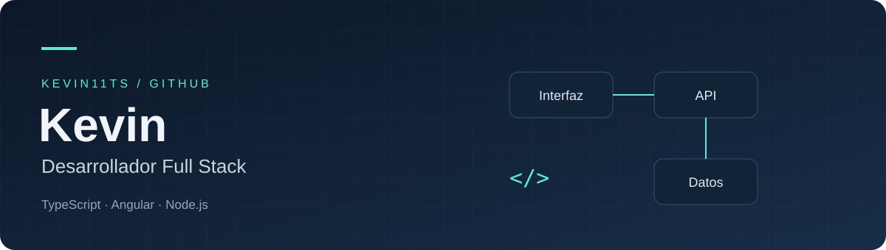

**Frontend, backend y datos. Una visión completa del desarrollo web.**

[Explorar repositorios](https://github.com/Kevin11ts?tab=repositories) · [Contribuciones](https://github.com/Kevin11ts?tab=overview) · [Conectar](#conecta-conmigo)

## Hola, soy Kevin

Soy **desarrollador full stack**. Mi trabajo abarca las distintas capas de una aplicación web: la interfaz, la lógica del servidor y las bases de datos.

Mi stack incluye **TypeScript, Angular y Node.js**, junto con **PostgreSQL, MySQL y Docker**. También exploro otras áreas del software con Java, Linux y Arduino.

<table>
  <tr>
    <td width="33%" valign="top">
      <h3>01 / Frontend</h3>
      
La interacción entre las personas y el software.

      
<strong>Angular · TypeScript JavaScript · HTML5</strong>

    </td>
    <td width="33%" valign="top">
      <h3>02 / Backend</h3>
      
La lógica que conecta la interfaz con los datos.

      
<strong>Node.js · TypeScript JavaScript</strong>

    </td>
    <td width="33%" valign="top">
      <h3>03 / Datos y entorno</h3>
      
Las herramientas que acompañan a la aplicación.

      
<strong>PostgreSQL · MySQL Docker · Linux · Git</strong>

    </td>
  </tr>
</table>

## Mi caja de herramientas

  

  
Más tecnologías

   
  
Java · Arduino · GitHub · Visual Studio Code

## Código y proyectos

Detrás de cada repositorio hay una parte de mi recorrido como desarrollador. Explora mi trabajo, revisa el código y conoce las tecnologías que utilizo.

**[Ver mis repositorios →](https://github.com/Kevin11ts?tab=repositories)**

<!-- Incorporar proyectos destacados con enlaces, contribución personal y resultados confirmados por Kevin. -->

## Conecta conmigo

Para conocer mi trabajo, visita mi [perfil de GitHub](https://github.com/Kevin11ts). También puedes encontrarme en mis redes personales:

[Instagram ↗](https://www.instagram.com/k_alexts1/) · [Facebook ↗](https://www.facebook.com/kevin.sandoval.153779/)

---

Kevin / Full Stack Developer

